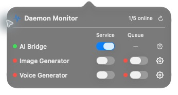
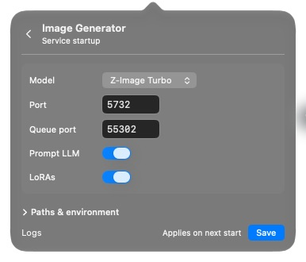

# Daemon Monitor

Your local AI services, one click away in the Mac menu bar. See what’s running and start or stop AI Bridge, Image Generator, and Voice Generator from a compact popover.



## Using the widget

Click the activity icon in the menu bar to open Daemon Monitor.

- **AI Bridge** has one on/off switch.
- **Image Generator** and **Voice Generator** each have separate **Service** and **Queue** switches.
- A **green dot** means healthy. A **red dot** means stopped, starting, or unhealthy. Hover over a dot to see the reason.
- The header shows how many of the five services are online. Click the refresh button for an immediate check.

Status updates every **15 seconds** while the popover is open and focused, and every **15 minutes** while hidden or unfocused. Opening it refreshes status immediately.

Starting a generator also starts or reuses its queue. Stopping the generator leaves the queue running. A busy generator will ask you to wait for its current job before stopping. Stopping AI Bridge also ends any provider work it is running.

Right-click the menu bar icon to refresh, open logs, or quit. Quitting Daemon Monitor leaves your services running. Hold Command and drag the icon to move it along the menu bar.

## Startup settings

Click the gear beside a row to change its startup options. For a generator, choose **Service settings…** or **Queue settings…**.



Choose a model, change ports, or adjust startup features. Expand **Paths & environment** for project folders, executables, and environment overrides.

Click **Save** to apply your choices the next time you start that service. Saving does not restart it. Going back discards unsaved edits. A generator and its queue share their project folder and queue port.

The [configuration reference](docs/REFERENCE.md) lists every option, default port, and supported model.

## Install

You’ll need:

- An Apple Silicon Mac running macOS 13 or later.
- Xcode Command Line Tools and Homebrew Python at `/opt/homebrew/bin/python3`.
- AI Bridge, ImageGen-Service, and VoiceGen-Service already installed, with the model runtimes you want to use. Daemon Monitor uses those installations; model setup and downloads happen in the services themselves.

```sh
git clone https://github.com/ashwinmahesh/DaemonMonitor.git
cd DaemonMonitor
./install.sh
```

The installer builds the app, puts it in `~/Applications`, and launches it. Daemon Monitor starts automatically when you log in and stays in the menu bar, with no Dock icon.

To update, pull the latest source and run `./install.sh` again. The previous app is kept as `~/Applications/Daemon Monitor.app.previous`. Installing or updating leaves your monitored services in their current state.

## If something is red

Hover over its dot for the reason. **Not started** means it is switched off; other messages explain startup or health failures. Open the row’s settings and click **Logs**, or right-click the menu bar icon and choose **Open logs** for more detail.

Settings and logs live in `~/Library/Application Support/DaemonMonitor`. If you change a port while a service is running, the monitor keeps checking its current address until you stop it and start it again.

## Uninstall

```sh
./uninstall.sh
```

This removes the app and its login entry. Your service installations, saved settings, and logs are kept.

For build commands, the control CLI, and implementation details, see the [developer notes](docs/REFERENCE.md#development).
